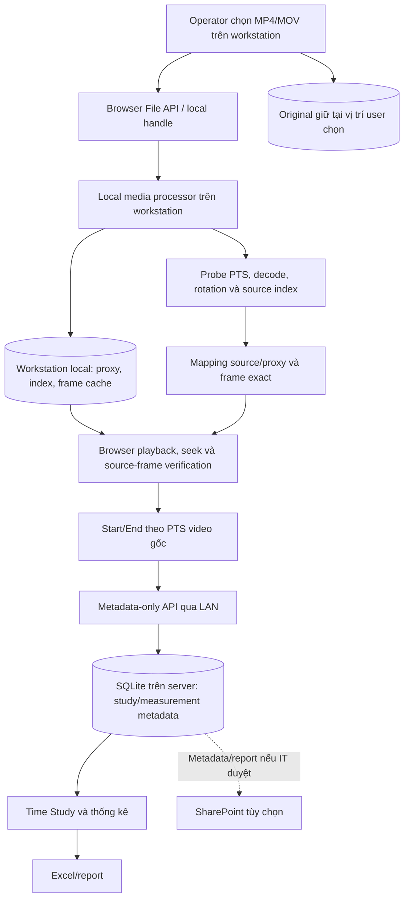

# Kiến trúc Motion Tracking / Video Time Study

Ngày khởi tạo: 2026-11-18 (Asia/Bangkok). **Kiến trúc nền tảng; có mã POC thử nghiệm local nhưng chưa đạt luồng user-local end-to-end.**

Đọc cùng [yêu cầu và D-01–D-10](PROJECT_REQUIREMENT.md), [kế hoạch task](IMPLEMENTATION_PLAN.md), [quy tắc agent](AGENTS.md) và [tiến độ](PROGRESS.md). Nguồn nghiệp vụ: tài liệu tổng hợp nội bộ v1.0 ngày 17/11/2026. Các chi tiết triển khai dưới đây là đề xuất kỹ thuật cần kiểm chứng trong task tương ứng; không coi mô tả là bằng chứng POC đạt.

## 1. Thành phần và ranh giới

| Thành phần | Trách nhiệm | POC và MVP |
| --- | --- | --- |
| React + TypeScript | Browser Chrome/Edge qua LAN; mở File local, player, frame/PTS verification, Start/End và timeline. File handle/object URL chỉ sống theo quyền của browser; không gửi file bytes hoặc local path lên API. | POC chọn video local và hiển thị bằng browser; MVP thêm library metadata, master, session, undo/redo, analytics và review. |
| FastAPI / Python | REST API cho study/measurement metadata, quyền và audit; không nhận hoặc phục vụ bytes video. SQLAlchemy/Alembic cho DB. | POC API chỉ lưu metadata cần thiết nếu được giao; contract hoàn chỉnh, validation, RBAC, revision và audit cho MVP. |
| Local media processor | Thành phần trên workstation user để probe/decode PTS, xử lý rotation, tạo proxy, frame index và ảnh source. Có thể là worker cục bộ hoặc browser runtime; lựa chọn còn mở tại D-10. | P0-05 phải chứng minh không upload media và mapping source PTS; MVP quản lý phiên bản/cache/recovery workstation. |
| FFprobe / FFmpeg | Đề xuất backend cho local media processor nếu IT cho phép; đọc PTS, decode, rotation, H.264 proxy và exact-frame PNG. | Chỉ chạy trên workstation user, theo chính sách IT; codec/profile thực tế phụ thuộc benchmark. Runtime browser thay thế cần được đánh giá tại D-10. |
| SQLite duy nhất | Business data và measurement metadata trên ổ local server; không chứa video bytes, proxy hoặc frame image. API server là thành phần truy cập DB. | P0-04 cho schema/migration; media index/cache chi tiết giữ local ở workstation. MVP lưu study/annotation metadata bền vững trong SQLite. |
| Vùng file local workstation | Original giữ tại đường dẫn user chọn; proxy, frame cache, index và temp nếu tạo thì ở app-data local của workstation, ngoài repo/sync. | Không copy original nếu không cần. Cách giữ handle/cache và mở lại sau phiên browser còn mở tại D-10. |
| Storage/sync providers | Không có media storage provider trên server theo yêu cầu hiện tại; SharePoint metadata/report tùy chọn sau D-03. | P0-09 xác minh IT; không sync original/proxy nếu chưa có phê duyệt riêng. |
| OpenCV / AI tools | Xử lý ảnh bổ sung khi cần; AI sau MVP. | Không bắt buộc cho gói player/timestamp đầu; không dùng FPS do OpenCV ước lượng làm thời gian chuẩn. |

### Lựa chọn runtime theo policy workstation (D-10)

Chủ dự án xác nhận user không thể tải phần mềm từ Internet hoặc chạy `.exe` tải về. Không vượt policy. Dùng browser/Windows có sẵn chỉ cho khả năng chúng thực sự cung cấp; thư viện JavaScript giao cùng ứng dụng vẫn là phần mềm và cần IT duyệt theo chính sách nội bộ.

| Phương án | Khả năng thực tế | Giới hạn / trạng thái |
| --- | --- | --- |
| Browser-native `<input type="file">`, File API, `URL.createObjectURL`, `<video>` | Mở file được user chọn và phát local trong Edge/Chrome; file bytes có thể ở trong browser, không cần upload hoặc cài thêm app. Có thể lấy frame đang phát qua canvas và thu media timeline bằng API browser phù hợp. | Phù hợp làm preview ngay khi web app được IT host/phân phối. `currentTime`/media timeline không phải contract raw PTS/time_base và seek không bảo đảm exact source frame. Chưa đủ cho Start/End được xác minh trong POC, đặc biệt VFR/rotation; cần kiểm chứng từng browser và codec. Giao diện hiện tại còn POST file lên FastAPI, vì vậy chưa dùng với video nhạy cảm cho đến khi loại upload. |
| [`requestVideoFrameCallback`](https://wicg.github.io/video-rvfc/) trên `<video>` | Callback cung cấp PTS theo timeline media của browser cho frame được trình bày, hữu ích nhận biết frame render. | Browser timeline có thể được chuẩn hóa và callback là tín hiệu trình bày, không phải source demux index/raw PTS/time_base; không tự cung cấp bảng ánh xạ mỗi frame source. Chỉ là bằng chứng phụ, không đủ tự nó để xác minh Start/End. |
| [WebCodecs](https://www.w3.org/TR/webcodecs/) + demuxer MP4/MOV viết bằng JavaScript | Có thể giải mã/encode frame trong browser khi codec/browser hỗ trợ; không cần executable cục bộ nếu web app chứa code. Trích ảnh PNG có thể dùng Canvas. | WebCodecs chỉ xử lý encoded chunks, không đọc cấu trúc container; cần demuxer riêng. H.264 encoder, codec/profile, MOV metadata/rotation, timestamp và muxer phải được capability-check và test. Mọi thư viện đi kèm vẫn phải được IT/security duyệt; chưa có bằng chứng chạy trên máy user. |
| [Windows Media Foundation Source Reader](https://learn.microsoft.com/en-us/windows/win32/medfound/processing-media-data-with-the-source-reader) | Thành phần Windows có thể đọc media local và trả sample timestamp; hỗ trợ format/codec tùy phiên bản Windows và codec đã cài. | API Source Reader cần ứng dụng/native bridge. Microsoft lưu ý seek có thể tới keyframe trước và phải đọc tiến tới frame yêu cầu; không tự frame-exact. Vì user không chạy executable mới, chỉ khả dụng nếu IT phê duyệt và triển khai thành phần phù hợp. |
| PyAV / FFmpeg libraries; GStreamer | Có thể cung cấp container parsing, PTS, decode và tùy build encode. | PyAV phụ thuộc FFmpeg libraries; GStreamer cần runtime/plugins. Không khả dụng trực tiếp theo policy hiện tại trừ khi IT triển khai/phê duyệt; không tải package hoặc binary thủ công. |
| Clipchamp / Photos / Media Player có sẵn | Có thể dùng thủ công để kiểm tra xem một file có phát được bằng ứng dụng đã cài sẵn hay không. | Là ứng dụng hướng người dùng, không phải API được xác nhận để Motion Tracking đọc raw PTS, tạo mapping, step exact-frame hoặc lưu annotation. Chỉ chẩn đoán playback, không làm media engine của app. |

Hướng ít phụ thuộc nhất là để IT host static web app/API trong LAN và dùng browser-native playback để xác nhận khả năng mở file. Trước khi bật đo lường, phải kiểm tra network không có media bytes/path upload, và giữ nút Start/End khóa đến khi source frame/PTS được xác minh. Nếu browser không đáp ứng, lựa chọn kế tiếp là đề nghị IT duyệt/đóng gói browser demuxer hoặc native media processor. Không chuyển video lên server để thay thế, do mâu thuẫn R-04/R-06.

Tài liệu kỹ thuật đối chiếu: [WICG frame callback](https://wicg.github.io/video-rvfc/), [W3C WebCodecs](https://www.w3.org/TR/webcodecs/), [Microsoft Source Reader và seek](https://learn.microsoft.com/en-us/windows/win32/medfound/processing-media-data-with-the-source-reader), [định dạng/codec Media Foundation](https://learn.microsoft.com/en-us/windows/win32/medfound/supported-media-formats-in-media-foundation).

Không đưa video vào queue/worker trên server. Nếu cần queue hoặc subprocess, processor và trạng thái xử lý media phải nằm ở workstation; chỉ metadata cần cho study mới trao đổi với API qua LAN. POC không cần đầy đủ auth, master data, approval, Excel hay SharePoint.

## 2. Luồng dữ liệu



Đây là luồng đích đề xuất theo ràng buộc user-local; POC phải chứng minh qua Network log rằng media bytes không gửi lên LAN API. Annotation/session lưu bền và Excel thuộc MVP, không phải cam kết của gói lập trình đầu. Client không được mở file `.db`, gửi local path hoặc truy cập đường dẫn server storage trực tiếp.

## 3. Vùng lưu trữ và job

SQLite/WAL/SHM và backup DB nằm trên ổ local server, ngoài OneDrive/SharePoint sync và NAS. Vùng app-data riêng ở workstation có thể giữ proxy, frame index, cache và processing manifest; không đặt trong repo hoặc thư mục sync. Mặc định đề xuất giữ original tại file user đã chọn và không tạo thêm bản sao; không gửi filename path hoặc FileSystem handle lên server.

Local media processor kiểm tra container/codec/giới hạn, tính SHA-256 và dựng index/proxy/frame. Chỉ công bố trạng thái `READY` khi PTS, mapping và exact-frame có thể kiểm chứng. Lỗi decode, thiếu dung lượng, file thay đổi hoặc mất quyền đọc phải thành lỗi rõ; không gửi media tới server để retry. Cache/idempotency/restart policy và quyền mở lại sau phiên browser cần được chốt tại D-10/P0-10.

API và thành phần DB chạy cùng host sở hữu SQLite. Bật `foreign_keys=ON`, `busy_timeout` trên mỗi connection, WAL và transaction ngắn; optimistic concurrency cho các bản ghi có thể sửa. DB chỉ lưu metadata study/measurement được phép; không lưu bytes video hay đường dẫn workstation. WAL vẫn chỉ có một writer tại một thời điểm; không coi WAL là cách cho nhiều server cùng mở DB. Ràng buộc cùng host được nêu trong [SQLite WAL](https://sqlite.org/wal.html).

## 4. Giữ timestamp video gốc, đặc biệt VFR

### 4.1. Nguồn thời gian chuẩn

Index theo **presentation order của frame đã decode**, không theo thứ tự packet/DTS. Mỗi source frame có `source_frame_id`, số thứ tự trình chiếu, stream ID, PTS ticks và `time_base` hữu tỉ gốc. Lưu cả raw timestamp và offset chuẩn hóa; `best_effort_timestamp` chỉ là fallback có cờ và phải benchmark, không âm thầm coi là ground truth. [FFprobe](https://ffmpeg.org/ffprobe.html) cung cấp metadata theo stream/frame qua `-show_streams`, `-show_frames` và đầu ra JSON.

Đề xuất một timeline chuẩn hóa dùng chung toàn video:

```text
source_time(frame) = pts_ticks(frame) × time_base_num / time_base_den
origin = thời điểm frame trình chiếu đầu tiên hợp lệ của stream được chọn
source_pts_us(frame) = round_to_nearest_us(source_time(frame) - origin)
duration_us = end_us - start_us
```

Tính bằng số nguyên/hữu tỉ trước khi làm tròn một lần, không tích lũy các delta đã làm tròn. Giữ raw ticks/time base/origin để đối chiếu lại; quy tắc xử lý tie khi làm tròn phải được ghi trong contract P0-02. Microsecond là đơn vị lưu, không phải cam kết độ chính xác hình ảnh đến microsecond.

Không dùng `frame_number / avg_fps`, `r_frame_rate`, thời gian chạy của máy hoặc `video.currentTime` làm nguồn thời gian chuẩn cho annotation. VFR có khoảng PTS không đều. Non-zero/negative start, edit list, B-frames và discontinuity phải nằm trong kiểm chứng; không tự reset PTS từng đoạn rồi cộng lại. Thiếu/trùng/không đơn điệu PTS sau chuẩn hóa hoặc frame không định danh được phải có trạng thái cảnh báo/unsupported; không cho lưu một phép đo có vẻ chính xác khi mapping chưa hợp lệ.

### 4.2. Proxy và chọn frame

Ưu tiên tạo proxy H.264 MP4 bảo toàn cadence/PTS trình chiếu và rotation đúng trên workstation, không ép CFR nếu chưa có lý do đã benchmark. Không giả định frame số N ở proxy luôn là frame số N ở source. Lưu mapping tường minh gồm proxy frame/PTS, source frame ID/PTS, transform thời gian, rotation và phiên bản pipeline; kiểm tra proxy/index local sau encode. Theo [FFmpeg](https://ffmpeg.org/ffmpeg.html), chế độ CFR có thể lặp/bỏ frame và muxer có thể đổi timestamp ngay cả khi chọn chế độ giữ timestamp; flag encode riêng lẻ không đủ chứng minh mapping đúng.

Nếu cần proxy CFR, mapping phải chỉ ra frame lặp/bị bỏ và sai lệch. **Tiến/lùi frame là tiến/lùi một source frame**, không phải một proxy frame. Đề xuất browser dùng proxy local để xem liên tục; khi pause/step/đặt mốc, local media processor decode đúng source frame (seek tới keyframe trước rồi decode tới frame đích) và trả ảnh kèm ID/PTS xác nhận. Cách này cũng dùng khi source frame không có ảnh tương ứng trong proxy. UI chờ ảnh đích render xong mới cho chốt Start/End; không gắn mốc vào ảnh cũ sau seek bất đồng bộ. Exact-frame endpoint trên FastAPI server không còn phù hợp với yêu cầu mới.

POC phải chứng minh lựa chọn player này trên Chrome/Edge; nếu không đạt hiệu năng thì báo giới hạn và đề xuất đổi giải pháp. Không tự thay thời gian gốc bằng thời gian proxy để che sai lệch.

### 4.3. Ranh giới annotation đề xuất

Dùng khoảng nửa mở `[start_us, end_us)`: Start là PTS đầu frame được chọn; End là ranh giới bắt đầu frame kế tiếp của phần thao tác, không tự cộng một frame theo FPS. UI cần diễn đạt rõ rằng frame tại End không thuộc khoảng đã đo. Lưu frame/boundary refs cùng số microsecond để audit.

Để chọn đến hết video, cần boundary kết thúc riêng được xác minh bằng PTS và duration frame cuối; không mặc định duration container luôn chính xác. Nếu thiếu bằng chứng, khóa terminal boundary và báo hạn chế. Frame ID phải phân biệt được cả khi timestamp bị trùng; trường hợp không ánh xạ duy nhất chưa được coi là hỗ trợ. Quy ước kỹ thuật này cần review ở P0-02 và kiểm chứng ở P0-08; không tự quyết định quy tắc nghiệp vụ overlap D-01.

### 4.4. Kiểm chứng

Manifest riêng ngoài repo cho video nhạy cảm ghi checksum, codec/stream, raw PTS/time base/origin, phiên bản FFmpeg, lệnh/cấu hình, mapping và ground truth. Fixtures tổng hợp không nhạy cảm phải có mốc thời gian đã biết để kiểm tra độc lập với pipeline; so sánh hình-frame gốc, PTS, Start/End và phép tính duration, gồm đầu/giữa/cuối, step hai chiều, seek, CFR/VFR, rotation và tình huống lỗi.

Đo boundary/duration error, max error, drift và latency trên cấu hình xác định. Ngưỡng chấp nhận video xưởng là **D-02 còn mở**, bộ video là **D-05 còn mở**; chưa có hai quyết định này thì không tuyên bố go/no-go xưởng. Chi tiết gói P0-05/06/08 ở [kế hoạch](IMPLEMENTATION_PLAN.md).

## 5. Mô hình dữ liệu mục tiêu

| Nhóm bảng | Vai trò và liên kết |
| --- | --- |
| `users`, `roles` | Actor và quyền; ma trận quyền theo D-06. |
| `groups`, `items`, `parts`, `stations` | Master data; quan hệ/routing chi tiết cần chốt ở P0-04/P1-02. |
| `videos` | Video ID tham chiếu opaque, SHA-256, stream/metadata và duration đã kiểm chứng; không lưu storage key hoặc workstation path. |
| `video_frame_index` | Metadata source/proxy refs, raw PTS/time base/origin và `source_pts_us` nếu cần query/audit; bản index đầy đủ và mapping media ở workstation local. |
| `work_templates`, `template_versions`, `work_elements` | Element, sequence, VA/NVA/NNVA theo version. |
| `study_sessions`, `study_revisions` | Video/template version, draft/review/approved, người và ngày duyệt, concurrency version. |
| `cycles`, `annotations` | Interval, frame/boundary refs; occurrence, nguồn manual/AI, notes; validity và exclusion reason. |
| `file_assets`, `sharepoint_files` | Report artifact/metadata provider, checksum; không đại diện media video; site/drive/item IDs và eTag chỉ lưu trong môi trường nội bộ. |
| `processing_jobs`, `sync_jobs` | Trạng thái job metadata-only và sync nếu bật; không claim server job để xử lý video. |
| `report_artifacts`, `audit_events` | Excel/revision/điều kiện thống kê, artifact checksum và lịch sử hành động. |

DB constraints bảo vệ khoảng hợp lệ và foreign keys; API/domain transaction kiểm tra containment, template version, trạng thái approval, concurrency và quy tắc D-01/D-09. Approved revision bất biến, tạo revision mới để sửa. Analytics và Excel đọc cùng snapshot/revision, không trộn dữ liệu đang sửa.

Không suy ra Standard Time từ cycle nhanh nhất. P0-07/P1-06 chỉ triển khai Normal/Standard Time khi D-08 đã duyệt. Tổng element duration và elapsed cycle là các đại lượng khác nhau khi có parallel work.

## 6. API và giao tiếp

Ranh giới dự kiến: metadata registration, master/templates, studies/revisions, cycles/annotations, analytics, report export, auth/review. Không có API upload original, serve proxy, trả frame image hoặc đọc file path local. Browser/local processor xử lý media; metadata-only API qua LAN có thể nhận checksum, codec/timeline facts, index version và measurement refs nhưng không nhận media bytes, proxy bytes, frame images, File object hoặc local path. API schema/endpoint cho ranh giới này cần chốt tại D-10; không tái sử dụng nguyên trạng OpenAPI có POST multipart /videos.

Luồng và contract POC được tóm tắt trong phần 9 bên dưới; chủ dự án đã duyệt Gate 1. File OpenAPI chi tiết chỉ lưu local theo quy tắc repo. Contract POC chưa bao gồm pagination, concurrency token và business API MVP; các phần đó cần thiết kế riêng khi được giao. Trạng thái triển khai và kiểm thử thực tế ở [PROGRESS.md](PROGRESS.md).

## 7. SharePoint khi được IT phê duyệt

P0-09 cần bằng chứng từ IT về Graph app registration, authentication phù hợp, quyền tối thiểu site/library, network/proxy và chính sách dữ liệu. Không giả định đăng nhập SharePoint bằng browser đồng nghĩa server dùng được Graph. Token/secret và mọi URL/ID nội bộ được cấu hình ngoài repo, không ghi vào log công khai.

Nếu được duyệt, SharePoint provider/sync worker chỉ xử lý metadata, báo cáo đã duyệt và sau này SOP images theo chính sách. Video gốc, proxy và frame cache ở workstation; upload media cần phê duyệt phạm vi riêng. SQLite giữ provider key, drive/item ID, eTag, checksum và trạng thái để đối soát. Luồng sync metadata dự kiến:

```text
PENDING → UPLOADING → VERIFYING → SYNCED
Lỗi tạm thời → RETRY_PENDING → UPLOADING
Lỗi cuối → FAILED; xung đột phiên bản → CONFLICT → xử lý có xác nhận
```

Retry có backoff và idempotency, kiểm tra item/version/kích thước và checksum metadata theo khả năng Graph; eTag riêng lẻ không thay checksum nội dung. P0-09 phải xác minh cách verify khả dụng, P0-10 thiết kế recovery và retention trước khi triển khai. Chỉ dọn metadata/report cache khi verify thành công và retention cho phép; sync metadata không xóa hoặc di chuyển video gốc trên workstation.

Nếu chỉ dùng SharePoint qua browser, server không có Internet hoặc IT không cấp quyền, tiếp tục local-only. NAS cho file/backup chỉ xét khi được phê duyệt; SQLite và vùng video làm việc vẫn local. Manual MVP không phụ thuộc sync thành công.

## 8. Vận hành, backup và phạm vi triển khai

Server LAN chạy frontend/API và SQLite; local media processor chạy trên workstation user. Windows/Linux, cách cài processor, quyền gọi FFmpeg/FFprobe, Docker Compose và HTTPS reverse proxy thuộc D-04/D-10; không coi Docker là điều kiện mặc định. Phiên bản dependency/media runtime phải pin khi lập trình và ghi vào bằng chứng benchmark. RBAC/audit ở MVP; giới hạn dung lượng workstation, concurrency metadata, retention, RPO/RTO và cơ chế đăng nhập chờ D-06/D-07.

Backup bằng [SQLite backup API](https://sqlite.org/backup.html), kèm approved report artifacts/metadata nếu policy yêu cầu và restore thử. Không sao lưu video source/proxy lên server/kho backup theo yêu cầu hiện tại. Không chỉ copy file `.db` đang hoạt động trong WAL rồi coi là backup đủ. Live DB vẫn local.

Kiểm thử dự kiến: pytest cho domain/API, integration cho DB/worker/backup và Playwright cho player/E2E; benchmark video và UAT thực tế. Kết quả đã chạy và giới hạn được ghi trong [PROGRESS.md](PROGRESS.md).

## 9. Luồng và contract Gate 1 cho POC

Chủ dự án xác nhận duyệt Gate 1; D-02 và D-05 vẫn mở. Ngày 2026-11-20, chủ dự án yêu cầu video gốc ở workstation user theo tham khảo 15.CIOS, không lưu trên server. Quy ước timestamp/End của Gate 1 vẫn giữ; luồng upload và API media trước đây không đáp ứng yêu cầu mới và cần thay contract sau khi giải quyết D-10. Các tiêu chí bên dưới là kế hoạch kiểm chứng, không khẳng định POC đã hoàn tất. OpenAPI, code và test được giữ tại workspace local.

### Luồng và ngoại lệ

1. IE chọn MP4/MOV trong browser bằng file picker. File gốc vẫn ở vị trí trên workstation; không upload bytes video hoặc đường dẫn local lên server. Browser tạo preview handle/object URL tạm; việc truy cập lại sau phiên browser phải được xử lý theo D-10.
2. Local media processor trên workstation kiểm tra container/codec và checksum, probe PTS, lập source index, xử lý rotation, tạo proxy/frame cache và mapping đã kiểm chứng. Browser phát proxy local. Trạng thái xử lý và khả năng chạy lại processor khi app/browser đóng còn mở tại D-10.
3. Sau seek/pause, local processor ánh xạ proxy presentation time tới source frame rồi decode ảnh gốc chính xác. Client xác minh reference theo source SHA, index version, ordinal và PTS; chờ ảnh render và xác nhận request mới nhất trước khi bật Start/End. Ảnh frame không được tải từ API server.
4. Tiến/lùi bằng ordinal source hiện tại ±1, không bước theo proxy frame. Ở đầu/cuối: vô hiệu nút tương ứng và giữ nguyên frame. Nếu không định danh đúng ảnh hoặc response local đến trễ, bỏ response cũ, báo chưa xác minh và khóa đánh dấu.
5. Đặt Start hoặc End theo source frame đã xác minh; có thể đặt End trước. Khi cả hai mốc đã có, validation yêu cầu `start_us < end_us`; mốc bằng nhau hoặc đảo trả lỗi và giữ nguyên mốc cũ. Thời lượng bằng `end_us - start_us`. POC manifest ở local; nếu gửi measurement metadata tới server, chỉ gửi source refs/PTS/hash, không gửi media.
6. Mở lại measurement đã lưu; user chọn lại source file hoặc cấp quyền handle theo phương án D-10, sau đó đối chiếu SHA-256/index version/raw PTS/normalized PTS. Khôi phục frame từ local processor, không dùng token cũ hay `currentTime` làm chứng cứ. Nếu file/index đổi hoặc frame không khôi phục được, báo lỗi và khóa phép đo; không âm thầm chọn frame gần nhất.

Video hỏng/codec không hỗ trợ, mất quyền đọc hoặc file bị di chuyển/thay đổi, PTS thiếu/trùng/không đơn điệu, rotation/mapping không xác minh, hết dung lượng workstation và lỗi decode đều phải hiển thị trạng thái/lý do cụ thể; không công bố `READY` hay chốt mốc sai. Nếu ảnh decode/render lỗi sau khi `READY`, chỉ khóa frame hiện tại và báo lỗi. Không đưa video nhạy cảm, manifest hoặc ảnh frame vào repo/API server.

### Timestamp, proxy và lưu mốc

Index source bắt đầu tại ordinal 0 theo thứ tự trình chiếu. `source_pts_ticks`, `origin_ticks` dùng cùng `time_base_num/time_base_den`, là số nguyên lưu dưới dạng chuỗi; `origin_ticks` là PTS frame đầu hợp lệ trong timeline được chọn sau demux. POC đánh dấu fallback timestamp hoặc edit list/discontinuity và chỉ chấp nhận khi mapping có thể xác minh. PTS trùng/thiếu/không đơn điệu hoặc trùng sau làm tròn microsecond không được hỗ trợ âm thầm.

`source_pts_us = round((source_pts_ticks - origin_ticks) × time_base_num × 1_000_000 / time_base_den)`; tính bằng số nguyên/hữu tỉ, làm tròn gần nhất, nếu đúng nửa thì ra xa 0. Timestamp đã chuẩn hóa và duration là số nguyên microsecond không vượt `9007199254740991` để JS biểu diễn chính xác; raw ticks vẫn giữ chuỗi. Đây là quy ước Gate 1 đã được duyệt, không phải ngưỡng chính xác thực tế.

Khoảng đo là `[Start, End)`: Start và End là PTS đầu hai frame gốc được chọn; frame tại End không nằm trong khoảng. Vì vậy để bao gồm frame cuối cần terminal boundary riêng có bằng chứng duration frame cuối; POC **chưa hỗ trợ chọn terminal boundary**, hiển thị giới hạn rõ. Không ước lượng bằng `frame/FPS` hay duration container.

Mapping được tạo và xác minh theo pipeline version: mỗi proxy presentation frame/PTS gắn source ordinal và PTS. Với proxy CFR, các bản sao có thể cùng chỉ một source frame; source frame bị bỏ không có proxy tương ứng nhưng vẫn có thể decode trực tiếp theo ordinal. Khi người dùng tua, vị trí proxy chỉ dùng tìm frame proxy đang trình chiếu trong khoảng PTS của nó; tra mapping để lấy source. Nếu không xác định duy nhất proxy frame/source hoặc mapping lỗi, trả `MAPPING_UNVERIFIED`, không làm tròn tới frame gần nhất. Step và khôi phục mốc luôn decode source trực tiếp; một proxy frame lặp không tạo thêm source frame.

Manifest measurement JSON POC lưu trên workstation ghi SHA-256 original, local index version, ordinal, raw ticks/time base/origin và normalized microseconds cho từng mốc. Ghi file tạm rồi đổi tên atomically; lỗi ghi giữ bản trước. Khi mở lại, user chọn lại source (hoặc dùng handle nếu D-10 cho phép) và app đối chiếu hash/index/PTS trước khi hiện mốc. Không lưu đường dẫn local trong manifest đưa lên server. Measurement nghiệp vụ MVP có thể lưu metadata-only trong SQLite; không chứa video bytes/proxy/frame images. Cách ký/xác minh source refs giữa local processor và API còn mở tại D-10.

**Ví dụ giả lập:** time base `1/1000` giây/tick, origin `1000`, Start ordinal 100 có PTS `5234`, End ordinal 147 có PTS `6790`. Start = `(5234−1000)×1000 = 4.234.000 µs`; End = `(6790−1000)×1000 = 5.790.000 µs`; duration = `1.556.000 µs = 1,556 giây`. Đây là ví dụ số học, không phải kết quả benchmark hoặc ngưỡng D-02.

**Đối chiếu độc lập dự kiến:** tạo fixture tổng hợp CFR/VFR có bảng ground truth do generator ghi trước khi encode: ordinal, thời điểm hữu tỉ, nhãn frame hiển thị và orientation; kiểm tra bằng công cụ/decoder tham chiếu độc lập với pipeline POC và đối chiếu nhãn hình ảnh, không chỉ so sánh hai kết quả cùng một thuật toán. Chọn mốc đầu/giữa/cuối, so raw PTS, source ordinal và `duration_us` với manifest; báo sai lệch boundary/duration từng mẫu, MAE, max, drift và seek/step latency kèm cấu hình. Với video xưởng, IE xác nhận ground truth và bảo quản bằng chứng nội bộ; D-02 và D-05 còn mở nên chưa có go/no-go xưởng.

### Ứng viên media runtime trên workstation — D-10 còn mở

Các phương án dưới đây là ứng viên để đánh giá, chưa phải quyết định hoặc kết quả kiểm thử:

| Phương án | Có thể thay phần nào | Giới hạn cần xác minh |
| --- | --- | --- |
| Browser File API + `<video>` | Mở/phát file local bằng decoder sẵn có trong Chrome/Edge; không cần upload file hay gọi FFprobe để preview. Đây là cách tham khảo từ 15.CIOS. | Chỉ coi là playback; phải chứng minh cách lấy PTS, định danh đúng frame sau seek, VFR và rotation trước khi bật annotation theo contract. Object URL/File permission có vòng đời theo browser. |
| Windows Media Foundation | API media có sẵn trong Windows; Source Reader có thể đọc sample/timestamp cục bộ, đơn vị thời gian 100 ns. Có thể đánh giá để tránh phụ thuộc executable FFmpeg/FFprobe riêng. [Architecture](https://learn.microsoft.com/en-us/windows/win32/medfound/overview-of-the-media-foundation-architecture) · [Source Reader](https://learn.microsoft.com/en-us/windows/win32/medfound/processing-media-data-with-the-source-reader). | Cần helper native trên workstation để gọi API; browser web không gọi trực tiếp Win32. Timestamp 100 ns phải đối chiếu với raw source PTS/time_base; Microsoft lưu ý seek không phải lúc nào cũng chính xác theo frame. Codec/container, VFR và rotation cần kiểm chứng. |
| PyAV | Python binding của FFmpeg libraries, có thể đọc container/stream/frame và `Frame.pts` cùng `time_base`; có thể thay lời gọi CLI FFprobe trong code Python. | Không loại bỏ dependency FFmpeg libraries; encode H.264/PNG và khả năng cài/chạy phụ thuộc build/wheel, policy IT và codec thực tế. [PyAV](https://pyav.org/docs/stable/) · [PTS/time_base](https://pyav.org/docs/stable/api/time.html). |
| GStreamer | Dùng `GstDiscoverer` để đọc thông tin media và pipeline decode cục bộ để nhận PTS của buffer; có thể thay FFprobe/FFmpeg CLI nếu plugin pipeline đáp ứng. | Cần xác minh plugin/container/decoder, rotation, frame seek, H.264 encoder và PNG trên máy Windows được phép; `PTS` có thể không có và phải fail rõ. [GstDiscoverer](https://gstreamer.freedesktop.org/documentation/pbutils/gstdiscoverer.html) · [GstBuffer PTS](https://gstreamer.freedesktop.org/documentation/gstreamer/gstbuffer.html). |

Clipchamp là ứng dụng biên tập có thể mở MP4/MOV, nhưng một số loại file được tự chuyển đổi khi nhập. Điều đó chỉ xác nhận trải nghiệm trong Clipchamp; chưa chứng minh có thể nhúng engine này vào Motion Tracking hoặc lấy chính xác source PTS/frame. [Định dạng Clipchamp](https://support.microsoft.com/en-gb/clipchamp/video-file-formats-supported-by-clipchamp).

Không phương án nào được chọn chỉ vì mở/phát được một clip. Tiêu chí chọn vẫn là xử lý hoàn toàn trên workstation, không gửi media bytes lên server, giữ PTS gốc cho CFR/VFR, rotation đúng, exact-frame khi tua/step, tạo proxy nếu cần và kiểm chứng capability theo chính sách IT. Nếu chỉ dùng browser playback mà chưa xác minh PTS/frame, khóa Start/End thay vì gán mốc không đáng tin cậy.

### Ranh giới API sau thay đổi yêu cầu lưu video

OpenAPI local hiện tại có `POST /videos` multipart, proxy/image routes và xử lý video phía server; contract đó **không còn phù hợp** và chưa được dùng làm contract cho phiên bản user-local. Không gửi original, proxy, ảnh frame, File object, đường dẫn hoặc FileSystem handle đến API LAN.

API mới chỉ được thiết kế cho metadata/measurement: tối thiểu cần xác định cách đăng ký opaque video reference + SHA-256/metadata, lưu/mở lại measurement và gửi Start/End source refs. Browser/local processor giữ quyền đọc original, tạo proxy/index/ảnh và xác minh frame. Cụ thể endpoint, token tin cậy, nơi lưu manifest POC và cách server kiểm tra metadata client cung cấp còn mở tại D-10; không tự coi timestamp do browser gửi là đã được server xác minh.

HTTP 413/415/416/507 từ contract cũ không còn mô tả luồng media mới. Các lỗi local cần hiển thị gồm file không truy cập được, checksum/index đổi, codec/PTS/rotation không hỗ trợ, thiếu dung lượng workstation và lỗi decode. API measurement vẫn cần `BAD_REQUEST`, `INVALID_INTERVAL` và lỗi concurrency/index theo contract mới.

### Đối chiếu AC-POC — kế hoạch, chưa phải kết quả

| Tiêu chí | Thiết kế/bằng chứng dự kiến | Trạng thái |
| --- | --- | --- |
| AC-POC-01 | Chọn MP4/MOV local, probe CFR/VFR/rotation, báo unsupported và kiểm tra network capture xác nhận không có media bytes tới server LAN. | Chưa chạy; luồng code hiện tại vẫn upload và cần thay. |
| AC-POC-02 | Proxy/index local mapping, source ordinal ±1, exact-frame/PTS, kiểm tra seek và đầu/cuối. | Chưa chạy. |
| AC-POC-03 | Lưu/khôi phục hai mốc, từ chối đảo/trùng, hiệu timestamp source; ảnh phải được xác minh. | Chưa chạy. |
| AC-POC-04 | Fixture/ground truth độc lập, so hình và PTS, boundary/duration error, drift, latency trên cấu hình ghi rõ. | Có fixture tổng hợp local; chưa benchmark POC. |
| AC-POC-05 | Video xưởng + ngưỡng do chủ dự án/IE duyệt; đánh giá và quyết định go/no-go. | Chờ D-02/D-05, chưa có kết quả. |
