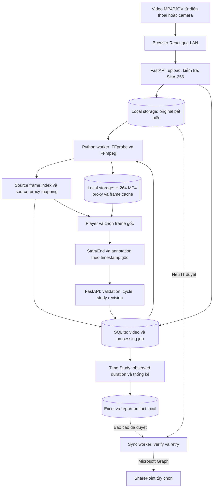

# Kiến trúc Motion Tracking / Video Time Study

Ngày khởi tạo: 2026-11-18 (Asia/Bangkok). **Thiết kế nền tảng để review, chưa có ứng dụng hoặc hạ tầng được triển khai.**

Đọc cùng [yêu cầu và D-01–D-09](PROJECT_REQUIREMENT.md), [kế hoạch task](IMPLEMENTATION_PLAN.md), [quy tắc agent](AGENTS.md) và [tiến độ](PROGRESS.md). Nguồn nghiệp vụ: tài liệu tổng hợp nội bộ v1.0 ngày 17/11/2026. Các chi tiết triển khai dưới đây là đề xuất kỹ thuật cần kiểm chứng trong task tương ứng; không coi mô tả là bằng chứng POC đạt.

## 1. Thành phần và ranh giới

| Thành phần | Trách nhiệm | POC và MVP |
| --- | --- | --- |
| React + TypeScript | Browser Chrome/Edge qua LAN; Vite; player, chọn frame, Start/End và timeline. Tailwind là lựa chọn trình bày theo nguồn. | Gói đầu chỉ player/đánh dấu/thời lượng/debug timestamp; MVP thêm library, master, session, undo/redo, analytics và review. |
| FastAPI / Python | REST API, kiểm tra đầu vào, phục vụ media có kiểm soát, quản lý dữ liệu và job; SQLAlchemy/Alembic cho DB. | POC có API tối thiểu; contract hoàn chỉnh, validation, RBAC, revision và audit cho MVP. |
| FFprobe / FFmpeg | Đọc metadata/frame PTS, decode, xử lý rotation, tạo proxy H.264 MP4 và mapping. | Bắt buộc trong gói P0-05/06/08; codec/profile thực tế phụ thuộc benchmark. |
| Python video worker riêng | Chạy probe/transcode/index ngoài request HTTP; báo tiến độ, lỗi và artifact. | POC có runner tối thiểu trên local; MVP có persistent queue/recovery, không để request giữ tác vụ dài. |
| SQLite duy nhất | Business data, frame index/mapping và job metadata. Chỉ API/worker cùng server truy cập. | P0-04 cho schema/migration; gói video đầu có thể dùng manifest local tạm trước schema đầy đủ. MVP phải lưu bền vững trong SQLite. |
| Vùng file local server | Original bất biến, proxy, frame cache, temp, reports và manifest. | Bắt buộc; nằm ngoài repo, ngoài thư mục sync. Không lưu video BLOB vào SQLite. |
| Storage providers | `LocalStorageProvider` là lõi; `SharePointStorageProvider` tùy chọn sau D-03. | SharePoint feasibility ở P0-09, recovery design ở P0-10; integration production chỉ khi được giao. |
| OpenCV / AI tools | Xử lý ảnh bổ sung khi cần; AI sau MVP. | Không bắt buộc cho gói player/timestamp đầu; không dùng FPS do OpenCV ước lượng làm thời gian chuẩn. |

Không bắt buộc Redis/Celery: đề xuất dùng `processing_jobs` trong SQLite và Python worker. Số worker và mức song song phải đo theo D-07. POC không cần đầy đủ auth, master data, approval, Excel hay SharePoint.

## 2. Luồng dữ liệu



Đây là luồng đích qua POC và MVP; annotation/session lưu bền và Excel thuộc MVP, không phải cam kết của gói lập trình đầu. Client không được mở file `.db` hoặc truy cập đường dẫn storage trực tiếp.

## 3. Vùng lưu trữ và job

Đề xuất các vùng cấu hình bằng biến môi trường ngoài repo: `database/`, `originals/`, `proxies/`, `frame-cache/`, `temp/`, `reports/`, `backups/`. Đây là tên logic trong vùng dữ liệu riêng của server, không phải yêu cầu tạo thư mục trong repo. SQLite cùng WAL/SHM phải ở ổ local server, tuyệt đối không trong OneDrive/SharePoint sync hoặc NAS.

Upload ghi file tạm, kiểm tra container/codec/giới hạn được duyệt, SHA-256 và metadata rồi mới công bố asset hoàn chỉnh. Storage key do server tạo; không dùng filename của người dùng làm đường dẫn tùy ý. Original chỉ đọc sau khi chấp nhận. Proxy/report là artifact có version, checksum và tham chiếu original/job; chuyển file tạm sang trạng thái sẵn sàng chỉ khi kiểm chứng xong.

Đề xuất processing state: `QUEUED → RUNNING → READY`, lỗi thành `FAILED`, có retry rõ ràng. Worker nhận job bằng transaction ngắn/claim nguyên tử, có attempt và lease/heartbeat để phát hiện lần chạy chết. Sau restart, recover job quá hạn theo chính sách; idempotency key theo video checksum + phiên bản pipeline + cấu hình để tránh công bố trùng. Không giữ transaction DB trong suốt quá trình encode. Job lỗi/thiếu dung lượng không được đánh dấu READY. POC chỉ cần chứng minh đường xử lý tối thiểu và lỗi rõ; queue/restart recovery đầy đủ thuộc P0-10/P1-01/P1-09.

API và worker chạy cùng host sở hữu SQLite. Bật `foreign_keys=ON`, `busy_timeout` trên mỗi connection, WAL và transaction ngắn; optimistic concurrency cho các bản ghi có thể sửa. WAL vẫn chỉ có một writer tại một thời điểm; không coi WAL là cách cho nhiều server cùng mở DB. Ràng buộc cùng host được nêu trong [SQLite WAL](https://sqlite.org/wal.html).

## 4. Giữ timestamp video gốc, đặc biệt VFR

### 4.1. Nguồn thời gian chuẩn

Index theo **presentation order của frame đã decode**, không theo thứ tự packet/DTS. Mỗi source frame có `source_frame_id`, số thứ tự trình chiếu, stream ID, PTS ticks và `time_base` hữu tỉ gốc. Lưu cả raw timestamp và offset chuẩn hóa; `best_effort_timestamp` chỉ là fallback có cờ và phải benchmark, không âm thầm coi là ground truth. [FFprobe](https://ffmpeg.org/ffprobe.html) cung cấp metadata theo stream/frame qua `-show_streams`, `-show_frames` và đầu ra JSON.

Đề xuất một timeline chuẩn hóa dùng chung toàn video:

```text
source_time(frame) = pts_ticks(frame) × time_base_num / time_base_den
origin = thời điểm frame trình chiếu đầu tiên hợp lệ của stream được chọn
source_pts_us(frame) = round_to_nearest_us(source_time(frame) - origin)
duration_us = end_us - start_us
```

Tính bằng số nguyên/hữu tỉ trước khi làm tròn một lần, không tích lũy các delta đã làm tròn. Giữ raw ticks/time base/origin để đối chiếu lại; quy tắc xử lý tie khi làm tròn phải được ghi trong contract P0-02. Microsecond là đơn vị lưu, không phải cam kết độ chính xác hình ảnh đến microsecond.

Không dùng `frame_number / avg_fps`, `r_frame_rate`, thời gian chạy của máy hoặc `video.currentTime` làm nguồn thời gian chuẩn cho annotation. VFR có khoảng PTS không đều. Non-zero/negative start, edit list, B-frames và discontinuity phải nằm trong kiểm chứng; không tự reset PTS từng đoạn rồi cộng lại. Thiếu/trùng/không đơn điệu PTS sau chuẩn hóa hoặc frame không định danh được phải có trạng thái cảnh báo/unsupported; không cho lưu một phép đo có vẻ chính xác khi mapping chưa hợp lệ.

### 4.2. Proxy và chọn frame

Ưu tiên tạo proxy H.264 MP4 bảo toàn cadence/PTS trình chiếu và rotation đúng, không ép CFR nếu chưa có lý do đã benchmark. Không giả định frame số N ở proxy luôn là frame số N ở source. Lưu mapping tường minh gồm proxy frame/PTS, source frame ID/PTS, transform thời gian, rotation và phiên bản pipeline; probe lại output và kiểm tra mapping sau encode. Theo [FFmpeg](https://ffmpeg.org/ffmpeg.html), chế độ CFR có thể lặp/bỏ frame và muxer có thể đổi timestamp ngay cả khi chọn chế độ giữ timestamp; flag encode riêng lẻ không đủ chứng minh mapping đúng.

Nếu cần proxy CFR, mapping phải chỉ ra frame lặp/bị bỏ và sai lệch. **Tiến/lùi frame là tiến/lùi một source frame**, không phải một proxy frame. Đề xuất player dùng proxy để xem liên tục; khi pause/step/đặt mốc, yêu cầu server decode đúng source frame (seek tới keyframe trước rồi decode tới frame đích) và hiển thị ảnh đó với ID/PTS xác nhận. Cách này cũng dùng khi source frame không có ảnh tương ứng trong proxy. UI chờ ảnh đích hiển thị xong mới cho chốt Start/End; không gắn mốc vào ảnh cũ sau seek bất đồng bộ.

POC phải chứng minh lựa chọn player này trên Chrome/Edge; nếu không đạt hiệu năng thì báo giới hạn và đề xuất đổi giải pháp. Không tự thay thời gian gốc bằng thời gian proxy để che sai lệch.

### 4.3. Ranh giới annotation đề xuất

Dùng khoảng nửa mở `[start_us, end_us)`: Start là PTS đầu frame được chọn; End là ranh giới bắt đầu frame kế tiếp của phần thao tác, không tự cộng một frame theo FPS. UI cần diễn đạt rõ rằng frame tại End không thuộc khoảng đã đo. Lưu frame/boundary refs cùng số microsecond để audit.

Để chọn đến hết video, cần boundary kết thúc riêng được xác minh bằng PTS và duration frame cuối; không mặc định duration container luôn chính xác. Nếu thiếu bằng chứng, khóa terminal boundary và báo hạn chế. Frame ID phải phân biệt được cả khi timestamp bị trùng; trường hợp không ánh xạ duy nhất chưa được coi là hỗ trợ. Quy ước kỹ thuật này cần review ở P0-02 và kiểm chứng ở P0-08; không tự quyết định quy tắc nghiệp vụ overlap D-01.

### 4.4. Kiểm chứng

Manifest riêng ngoài repo cho video nhạy cảm ghi checksum, codec/stream, raw PTS/time base/origin, phiên bản FFmpeg, lệnh/cấu hình, mapping và ground truth. Fixtures tổng hợp không nhạy cảm phải có mốc thời gian đã biết để kiểm tra độc lập với pipeline; so sánh hình-frame gốc, PTS, Start/End và phép tính duration, gồm đầu/giữa/cuối, step hai chiều, seek, CFR/VFR, rotation và tình huống lỗi.

Đo boundary/duration error, max error, drift và latency trên cấu hình xác định. Ngưỡng chấp nhận video xưởng là **D-02 còn mở**, bộ video là **D-05 còn mở**; chưa có hai quyết định này thì không tuyên bố go/no-go xưởng. Chi tiết gói P0-05/06/08 ở [kế hoạch](IMPLEMENTATION_PLAN.md).

## 5. Mô hình dữ liệu mục tiêu

| Nhóm bảng | Vai trò và liên kết |
| --- | --- |
| `users`, `roles` | Actor và quyền; ma trận quyền theo D-06. |
| `groups`, `items`, `parts`, `stations` | Master data; quan hệ/routing chi tiết cần chốt ở P0-04/P1-02. |
| `videos` | Video ID, SHA-256, storage key, stream/metadata, duration đã kiểm chứng và processing status. |
| `video_frame_index` | Source/proxy frame refs, raw PTS/time base/origin và `source_pts_us`; mapping có version. Có thể tách bảng mapping khi thiết kế schema đầy đủ. |
| `work_templates`, `template_versions`, `work_elements` | Element, sequence, VA/NVA/NNVA theo version. |
| `study_sessions`, `study_revisions` | Video/template version, draft/review/approved, người và ngày duyệt, concurrency version. |
| `cycles`, `annotations` | Interval, frame/boundary refs; occurrence, nguồn manual/AI, notes; validity và exclusion reason. |
| `file_assets`, `sharepoint_files` | Provider, storage key, checksum; site/drive/item IDs và eTag chỉ lưu trong môi trường nội bộ. |
| `processing_jobs`, `sync_jobs` | Claim/attempt/progress/lease/error/retry và trạng thái sync nếu bật. |
| `report_artifacts`, `audit_events` | Excel/revision/điều kiện thống kê, artifact checksum và lịch sử hành động. |

DB constraints bảo vệ khoảng hợp lệ và foreign keys; API/domain transaction kiểm tra containment, template version, trạng thái approval, concurrency và quy tắc D-01/D-09. Approved revision bất biến, tạo revision mới để sửa. Analytics và Excel đọc cùng snapshot/revision, không trộn dữ liệu đang sửa.

Không suy ra Standard Time từ cycle nhanh nhất. P0-07/P1-06 chỉ triển khai Normal/Standard Time khi D-08 đã duyệt. Tổng element duration và elapsed cycle là các đại lượng khác nhau khi có parallel work.

## 6. API và giao tiếp

Ranh giới dự kiến: upload/media, video metadata/frame index/exact-frame, job status, master/templates, studies/revisions, cycles/annotations, analytics, report export, auth/review. Browser nhận asset qua API hoặc media route được kiểm soát, có HTTP range khi phát proxy. MVP dự kiến dùng job ID để poll; draft POC dùng video ID để poll trạng thái xử lý.

Luồng và contract POC được tóm tắt trong phần 9 bên dưới; chủ dự án đã duyệt Gate 1. File OpenAPI chi tiết chỉ lưu local theo quy tắc repo. Contract POC chưa bao gồm pagination, concurrency token và business API MVP; các phần đó cần thiết kế riêng khi được giao. Trạng thái triển khai và kiểm thử thực tế ở [PROGRESS.md](PROGRESS.md).

## 7. SharePoint khi được IT phê duyệt

P0-09 cần bằng chứng từ IT về Graph app registration, authentication phù hợp, quyền tối thiểu site/library, network/proxy và chính sách dữ liệu. Không giả định đăng nhập SharePoint bằng browser đồng nghĩa server dùng được Graph. Token/secret và mọi URL/ID nội bộ được cấu hình ngoài repo, không ghi vào log công khai.

Nếu được duyệt, `SharePointStorageProvider` và sync worker chuyển original, báo cáo đã duyệt và sau này SOP images theo chính sách. SQLite giữ provider key, drive/item ID, eTag, checksum và trạng thái để đối soát. Luồng sync dự kiến:

```text
PENDING → UPLOADING → VERIFYING → SYNCED
Lỗi tạm thời → RETRY_PENDING → UPLOADING
Lỗi cuối → FAILED; xung đột phiên bản → CONFLICT → xử lý có xác nhận
```

Retry có backoff và idempotency, tiếp tục upload phù hợp khi có thể, kiểm tra item/version/kích thước và nội dung/checksum theo khả năng Graph; eTag riêng lẻ không thay checksum nội dung. P0-09 phải xác minh cách verify khả dụng, P0-10 thiết kế recovery và retention trước khi triển khai. Chỉ dọn cache khi verify thành công, không còn job/study cần file và retention đã cho phép; original local không tự xóa chỉ vì upload trả thành công.

Nếu chỉ dùng SharePoint qua browser, server không có Internet hoặc IT không cấp quyền, tiếp tục local-only. NAS cho file/backup chỉ xét khi được phê duyệt; SQLite và vùng video làm việc vẫn local. Manual MVP không phụ thuộc sync thành công.

## 8. Vận hành, backup và phạm vi triển khai

Server LAN chạy frontend/API và worker dưới service phù hợp. Windows/Linux, Docker Compose và HTTPS reverse proxy là D-04; không coi Docker là điều kiện mặc định. Phiên bản dependency/FFmpeg phải pin khi lập trình và ghi vào bằng chứng benchmark. RBAC/audit ở MVP; giới hạn upload, dung lượng, concurrency, retention, RPO/RTO và cơ chế đăng nhập chờ D-06/D-07.

Backup bằng [SQLite backup API](https://sqlite.org/backup.html), kèm file assets/manifest tương ứng và restore thử. Không chỉ copy file `.db` đang hoạt động trong WAL rồi coi là backup đủ. Thiết kế checkpoint/snapshot phối hợp metadata và file để restore không mất liên kết. Bản backup có thể chuyển đến kho được IT duyệt sau khi tạo snapshot an toàn; live DB vẫn local.

Kiểm thử dự kiến: pytest cho domain/API, integration cho DB/worker/backup và Playwright cho player/E2E; benchmark video và UAT thực tế. Kết quả đã chạy và giới hạn được ghi trong [PROGRESS.md](PROGRESS.md).

## 9. Luồng và contract Gate 1 cho POC

Chủ dự án xác nhận duyệt Gate 1; D-02 và D-05 vẫn mở. Các tiêu chí bên dưới là kế hoạch kiểm chứng, không khẳng định POC đã hoàn tất. OpenAPI, code và test được giữ tại workspace local.

### Luồng và ngoại lệ

1. IE chọn MP4/MOV; server nhận file qua LAN vào vùng tạm local, kiểm tra container/codec và checksum, lưu original bất biến. Trả `video_id`; UI theo dõi `QUEUED`, `RUNNING`, `READY` hoặc `FAILED` qua API. Khi `FAILED`, hiện lỗi và cho chọn lại file; không cho đánh dấu.
2. Worker probe, lập index presentation order, tạo proxy H.264 MP4 đã xoay và mapping. Khi `READY`, UI phát/tua proxy. Sau tua hoặc tạm dừng, client yêu cầu ánh xạ vị trí proxy tới source frame; nếu ánh xạ không duy nhất hoặc không hợp lệ, hiện trạng thái chưa xác minh, yêu cầu chọn frame theo ordinal hoặc xử lý lại.
3. API trả frame gốc, raw PTS, thời gian chuẩn hóa, `frame_token` và URL ảnh exact-frame. Client tải ảnh, kiểm tra token trong response, đợi ảnh decode/render và xác nhận đây vẫn là request mới nhất trước khi bật Start/End. Sau lần seek/step mới, đổi video hoặc lỗi tải ảnh, vô hiệu xác nhận cũ. Server chỉ xác thực token tương ứng frame; server không thể tự chứng minh người dùng đã thấy ảnh.
4. Tiến/lùi bằng ordinal source hiện tại ±1, không bước theo proxy frame. Ở đầu/cuối: vô hiệu nút tương ứng và giữ nguyên frame. Nếu không định danh đúng ảnh hoặc response đến trễ, bỏ response cũ, báo chưa xác minh và khóa đánh dấu.
5. Tạo measurement tạm, đặt Start hoặc End theo token của frame đã hiển thị; có thể đặt End trước. Khi cả hai mốc đã có, server chỉ chấp nhận `start_us < end_us`; mốc bằng nhau hoặc đảo trả `422 INVALID_INTERVAL`, giữ nguyên mốc cũ. Thời lượng bằng `end_us - start_us`.
6. Tải lại measurement đã lưu; chọn quay lại Start/End bằng ordinal đã lưu, đối chiếu checksum, index version, raw PTS và normalized PTS. API tạo token mới và UI tải lại ảnh exact-frame theo bước 3; không dùng token cũ hay `currentTime` làm chứng cứ. Nếu file/index thay đổi hoặc không khôi phục được đúng frame, báo lỗi và khóa phép đo; không âm thầm chọn frame gần nhất.

Video hỏng/codec không hỗ trợ, PTS thiếu/trùng/không đơn điệu, rotation hoặc mapping không xác minh, hết dung lượng và lỗi decode đều phải hiển thị trạng thái/lý do cụ thể; không công bố `READY` hay chốt mốc sai. Nếu ảnh tải hoặc decode lỗi sau khi `READY`, chỉ khóa frame hiện tại và báo lỗi. Không đưa video nhạy cảm, manifest hoặc ảnh frame vào repo.

### Timestamp, proxy và lưu mốc

Index source bắt đầu tại ordinal 0 theo thứ tự trình chiếu. `source_pts_ticks`, `origin_ticks` dùng cùng `time_base_num/time_base_den`, là số nguyên lưu dưới dạng chuỗi; `origin_ticks` là PTS frame đầu hợp lệ trong timeline được chọn sau demux. POC đánh dấu fallback timestamp hoặc edit list/discontinuity và chỉ chấp nhận khi mapping có thể xác minh. PTS trùng/thiếu/không đơn điệu hoặc trùng sau làm tròn microsecond không được hỗ trợ âm thầm.

`source_pts_us = round((source_pts_ticks - origin_ticks) × time_base_num × 1_000_000 / time_base_den)`; tính bằng số nguyên/hữu tỉ, làm tròn gần nhất, nếu đúng nửa thì ra xa 0. Timestamp đã chuẩn hóa và duration là số nguyên microsecond không vượt `9007199254740991` để JS biểu diễn chính xác; raw ticks vẫn giữ chuỗi. Đây là quy ước Gate 1 đã được duyệt, không phải ngưỡng chính xác thực tế.

Khoảng đo là `[Start, End)`: Start và End là PTS đầu hai frame gốc được chọn; frame tại End không nằm trong khoảng. Vì vậy để bao gồm frame cuối cần terminal boundary riêng có bằng chứng duration frame cuối; POC **chưa hỗ trợ chọn terminal boundary**, hiển thị giới hạn rõ. Không ước lượng bằng `frame/FPS` hay duration container.

Mapping được tạo và xác minh theo pipeline version: mỗi proxy presentation frame/PTS gắn source ordinal và PTS. Với proxy CFR, các bản sao có thể cùng chỉ một source frame; source frame bị bỏ không có proxy tương ứng nhưng vẫn có thể decode trực tiếp theo ordinal. Khi người dùng tua, vị trí proxy chỉ dùng tìm frame proxy đang trình chiếu trong khoảng PTS của nó; tra mapping để lấy source. Nếu không xác định duy nhất proxy frame/source hoặc mapping lỗi, trả `MAPPING_UNVERIFIED`, không làm tròn tới frame gần nhất. Step và khôi phục mốc luôn decode source trực tiếp; một proxy frame lặp không tạo thêm source frame.

Manifest measurement JSON local lưu `video_id`, SHA-256 original, index version, ordinal, raw ticks/time base/origin, normalized microseconds cho từng mốc. API ghi file tạm rồi đổi tên atomically; ghi lỗi giữ bản trước. Khi mở lại, đối chiếu mọi trường với original/index hiện tại trước khi tạo token mới. Token chỉ là tham chiếu ngắn hạn đến frame của index hiện tại, không dùng làm danh tính lâu dài. Việc lưu này phục vụ POC, không tạo session nghiệp vụ MVP hoặc tích hợp SQLite.

**Ví dụ giả lập:** time base `1/1000` giây/tick, origin `1000`, Start ordinal 100 có PTS `5234`, End ordinal 147 có PTS `6790`. Start = `(5234−1000)×1000 = 4.234.000 µs`; End = `(6790−1000)×1000 = 5.790.000 µs`; duration = `1.556.000 µs = 1,556 giây`. Đây là ví dụ số học, không phải kết quả benchmark hoặc ngưỡng D-02.

**Đối chiếu độc lập dự kiến:** tạo fixture tổng hợp CFR/VFR có bảng ground truth do generator ghi trước khi encode: ordinal, thời điểm hữu tỉ, nhãn frame hiển thị và orientation; kiểm tra bằng công cụ/decoder tham chiếu độc lập với pipeline POC và đối chiếu nhãn hình ảnh, không chỉ so sánh hai kết quả cùng một thuật toán. Chọn mốc đầu/giữa/cuối, so raw PTS, source ordinal và `duration_us` với manifest; báo sai lệch boundary/duration từng mẫu, MAE, max, drift và seek/step latency kèm cấu hình. Với video xưởng, IE xác nhận ground truth và bảo quản bằng chứng nội bộ; D-02 và D-05 còn mở nên chưa có go/no-go xưởng.

### Tóm tắt endpoint POC

Các endpoint dùng prefix `/api/poc`; contract OpenAPI chi tiết lưu local.

| Endpoint | Request | Response thành công |
| --- | --- | --- |
| `POST /videos` | Multipart `file` MP4/MOV. | `202` video ID và trạng thái xử lý. |
| `GET /videos/{video_id}` | Video ID. | `200` status, checksum/index/metadata khi sẵn sàng hoặc lỗi. |
| `GET /videos/{video_id}/proxy` | Range tùy chọn. | `200`/`206` video MP4 và Content-Range cho một phần. |
| `POST /videos/{video_id}/frame-selection` | Một trong `source_ordinal` hoặc `proxy_pts_us`. | `200` frame gốc, raw PTS/time base/origin, microseconds, checksum/index, token và image URL. |
| `GET /videos/{video_id}/frames/{source_ordinal}/image` | Ordinal và `frame_token`. | `200` ảnh PNG và `X-Frame-Token`. |
| `POST /videos/{video_id}/measurements` | Video ID. | `201` measurement ID, marks rỗng và duration null. |
| `GET /measurements/{measurement_id}` | Measurement ID. | `200` marks đã lưu và duration; kiểm tra nguồn/index. |
| `PUT /measurements/{measurement_id}/marks/{role}` | Role `start/end`, JSON `frame_token`. | `200` measurement; tính duration khi đủ hai mốc hợp lệ. |

### Cách dùng contract và lỗi

Contract OpenAPI chi tiết được lưu local; phần này mô tả request/response, thời gian và status. Các bước tiêu biểu: `POST /videos` → poll `GET /videos/{video_id}` → `GET /videos/{video_id}/proxy` → `POST /videos/{video_id}/frame-selection` với `{"source_ordinal":100}` hoặc `{"proxy_pts_us":4234000}` → tải `image_url` → `POST /videos/{video_id}/measurements` → `PUT /measurements/{measurement_id}/marks/start` với `{"frame_token":"<token-tu-frame>"}` → đặt End tương tự → `GET /measurements/{measurement_id}` để mở lại. `proxy_pts_us` thuộc timeline proxy, không phải source time; ví dụ chỉ minh họa cấu trúc.

`Frame` trả `image_url` có token tương ứng; response ảnh mang `X-Frame-Token` giống token đã cấp. Token gắn video/checksum/index/ordinal và hết hiệu lực khi index hoặc video thay đổi; client chỉ gửi mark khi đã xác minh ảnh. Measurement trả `marks` rỗng/một/hai mốc và `duration_us: null` khi chưa đủ; server không tin PTS do client tự gửi. Hai mốc phải thuộc cùng original/index. GET measurement trả `409 INDEX_CHANGED` nếu checksum/index hiện tại không khớp.

Ví dụ response rút gọn về cấu trúc, trong đó `<sha256>` và `<token>` là placeholder:

```json
{
  "measurement_id": "m1", "video_id": "v1",
  "marks": {
    "start": {"original_sha256":"<sha256>", "index_version":"i1", "source_ordinal":100,
      "source_pts_ticks":"5234", "time_base_num":1, "time_base_den":1000,
      "origin_ticks":"1000", "source_pts_us":4234000},
    "end": {"original_sha256":"<sha256>", "index_version":"i1", "source_ordinal":147,
      "source_pts_ticks":"6790", "time_base_num":1, "time_base_den":1000,
      "origin_ticks":"1000", "source_pts_us":5790000}
  },
  "duration_us": 1556000
}
```

Ví dụ lỗi mốc trùng hoặc đảo: HTTP `422`, `{"code":"INVALID_INTERVAL","message":"End phải sau Start"}`. Các trường request/response đầy đủ được quy định trong schema OpenAPI; placeholder trong ví dụ không phải giá trị SHA-256 thực.

| HTTP / code ví dụ | Ý nghĩa / hành vi |
| --- | --- |
| 400 `BAD_REQUEST` | Sai dạng request; sửa request. |
| 404 `NOT_FOUND` | Video, measurement hoặc ordinal không tồn tại. |
| 409 `VIDEO_NOT_READY`, `INDEX_CHANGED`, `STALE_FRAME` | Chưa xử lý xong, nguồn/index đổi, token cũ; chờ hoặc tải lại và xác minh frame. |
| 413 `FILE_TOO_LARGE`; 415 `UNSUPPORTED_MEDIA` | Quá giới hạn cấu hình hoặc định dạng/codec không được hỗ trợ. |
| 416 `RANGE_NOT_SATISFIABLE` | Range proxy không hợp lệ. |
| 422 `INVALID_INTERVAL`, `MAPPING_UNVERIFIED`, `PTS_INVALID`, `FRAME_DECODE_FAILED` | Mốc bằng/đảo, mapping/PTS không tin cậy hoặc decode lỗi; giữ dữ liệu cũ và báo rõ. |
| 507 `STORAGE_FULL` | Không đủ dung lượng; không công bố file/mốc ghi dở. |

Đường dẫn local là cấu hình của server, dùng ID do server tạo và nằm ngoài repo: `originals/<video_id>/`, `proxies/<video_id>/<index_version>/`, `indexes/<video_id>/<index_version>/`, `measurements/`, `temp/`. Original không sửa; proxy/index chỉ công bố khi hoàn chỉnh, lưu checksum/version. Không trả đường dẫn file hệ thống, credential hay dữ liệu riêng vào API/log công khai. D-06 còn mở cho retention và quyền sử dụng video xưởng.

### Đối chiếu AC-POC — kế hoạch, chưa phải kết quả

| Tiêu chí | Thiết kế/bằng chứng dự kiến | Trạng thái |
| --- | --- | --- |
| AC-POC-01 | Upload MP4/MOV, probe CFR/VFR/rotation và báo unsupported; fixture theo manifest. | Chưa chạy. |
| AC-POC-02 | Proxy mapping, source ordinal ±1, exact-frame/PTS, kiểm tra seek và đầu/cuối. | Chưa chạy. |
| AC-POC-03 | Lưu/khôi phục hai mốc, từ chối đảo/trùng, hiệu timestamp source; ảnh phải được xác minh. | Chưa chạy. |
| AC-POC-04 | Fixture/ground truth độc lập, so hình và PTS, boundary/duration error, drift, latency trên cấu hình ghi rõ. | Có fixture tổng hợp local; chưa benchmark POC. |
| AC-POC-05 | Video xưởng + ngưỡng do chủ dự án/IE duyệt; đánh giá và quyết định go/no-go. | Chờ D-02/D-05, chưa có kết quả. |
